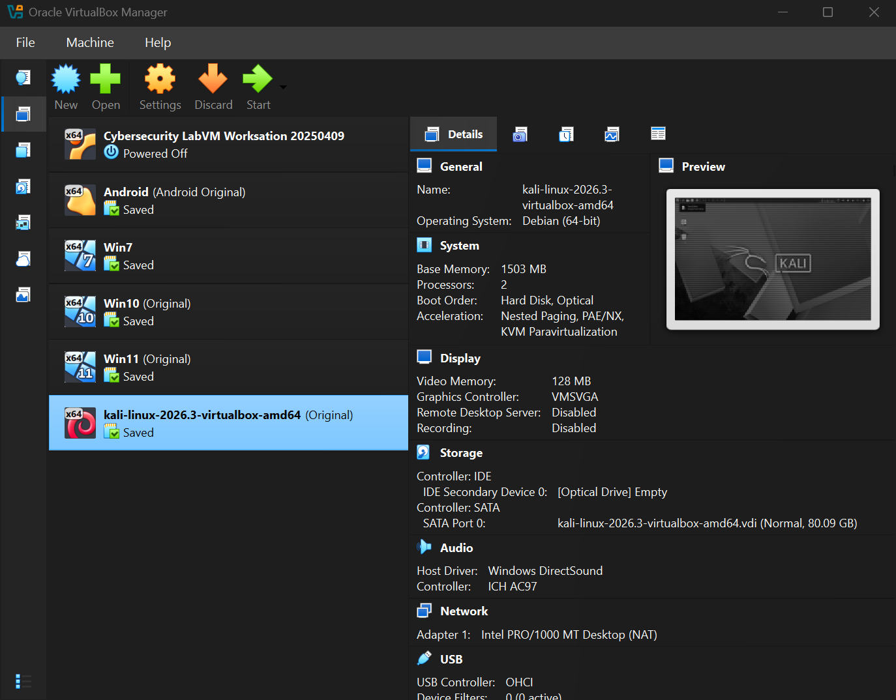
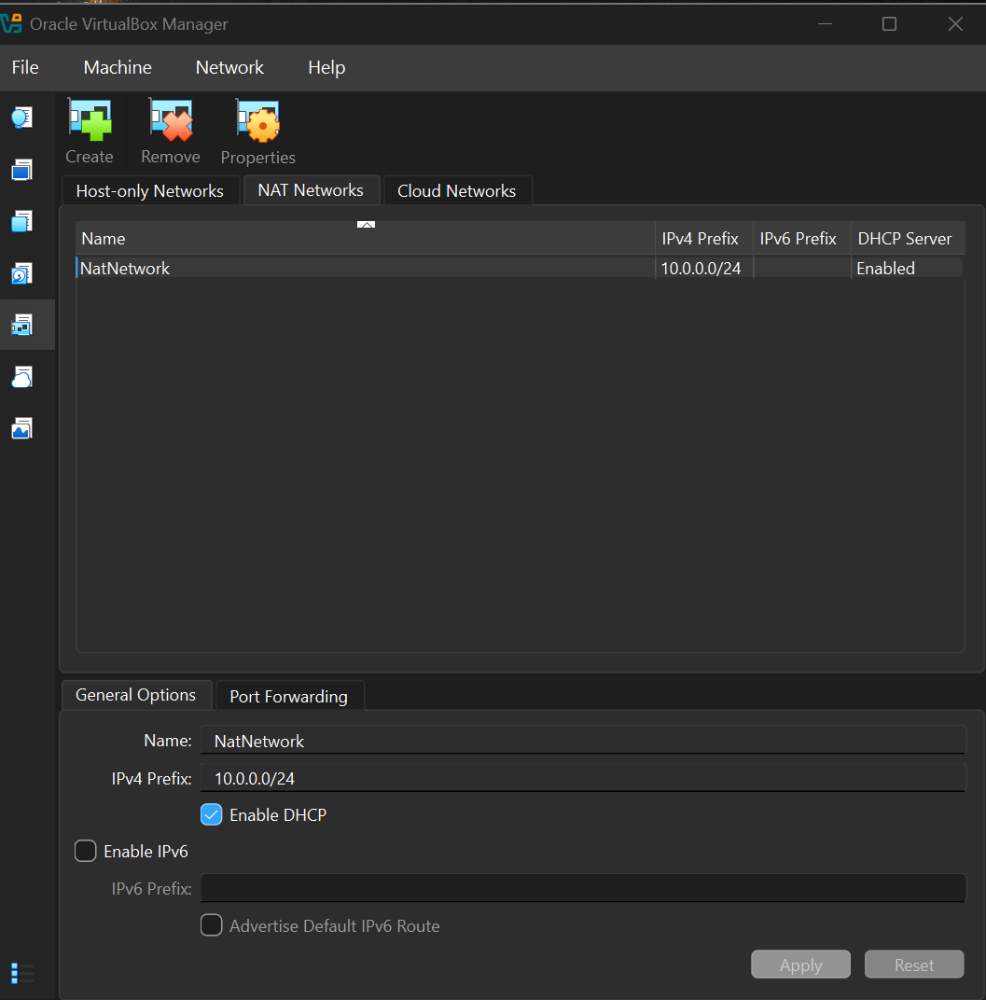
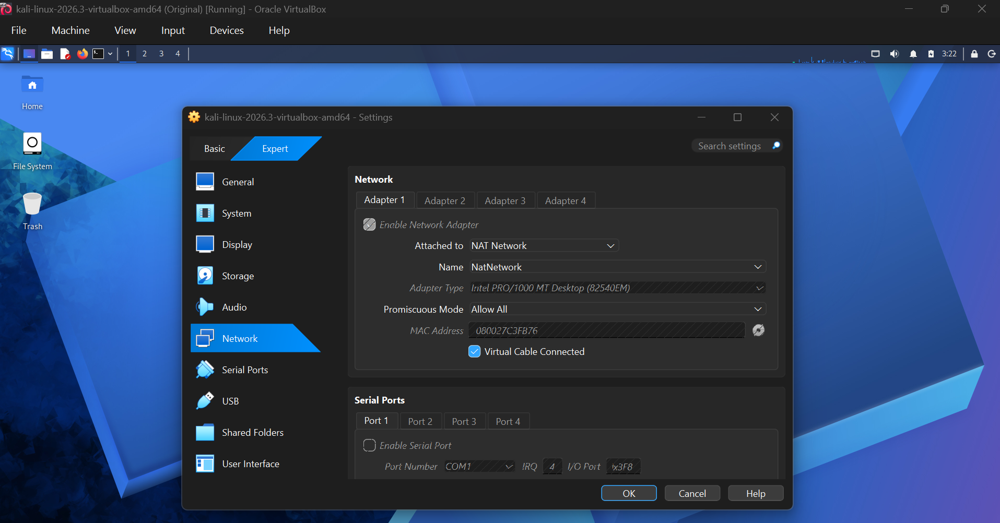
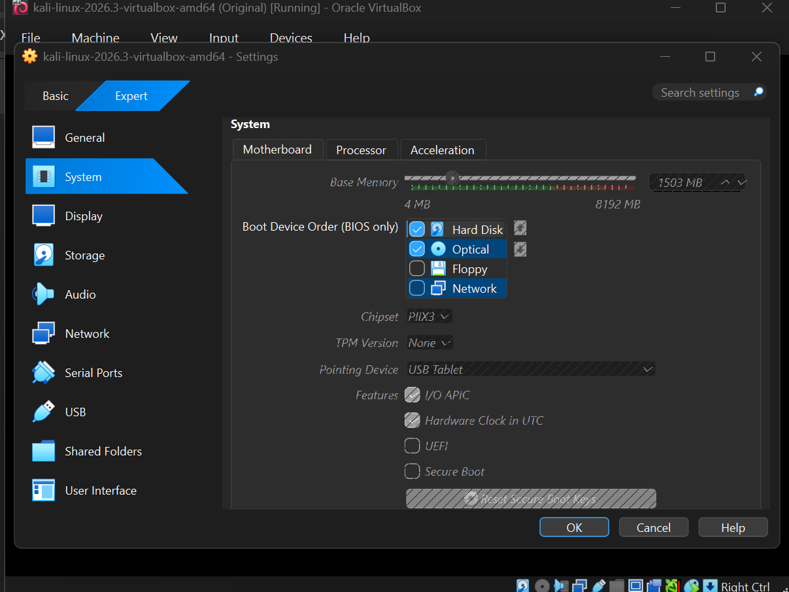
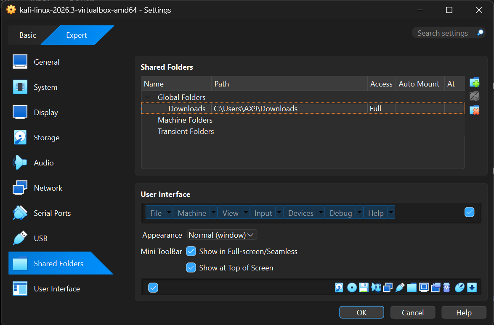
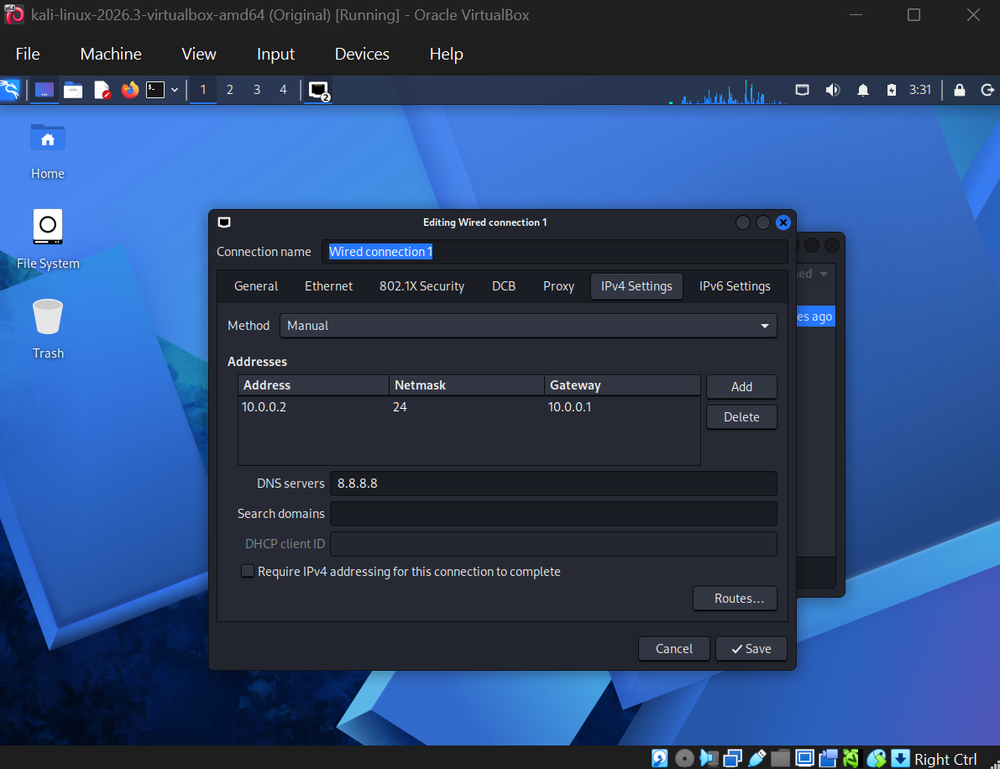
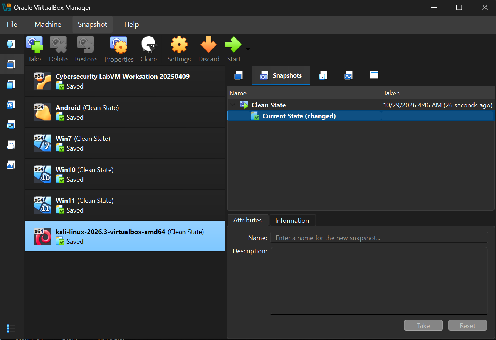
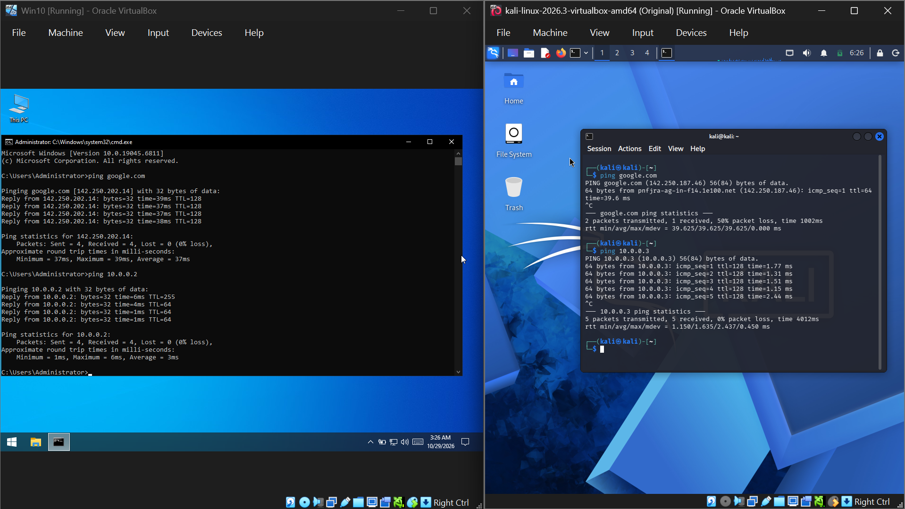

<div align="center">

# 🔐 Cybersecurity Lab Environment Setup

**Building an isolated virtual lab for penetration testing and ethical hacking practice**
</div>

<p align="center">
  
  
  
  
  
  
  
  
  
  
  
</p>

---

## 📌 Project Overview

This project focuses on setting up a **virtual cybersecurity and penetration-testing laboratory** using VirtualBox, Kali Linux and some other Operating Systems acting as targets.

The purpose of the lab is to create a controlled environment where cybersecurity tools, network scanning, reconnaissance, vulnerability assessment, and other security-testing activities can be performed safely and repeatedly.


---


## 🎯 Objectives

The main objectives of this project are to:

- Install and configure VirtualBox.
- Install/import Kali Linux and other Operating Systems as virtual machines.
- Create a private **NAT Network** for the cybersecurity lab.
- Configure network connectivity for these Operating Systems.
- Assign a consistent IP address to each Operating System.
- Verify network connectivity.
- Take a clean VM snapshot for recovery.
- Document the complete setup process.

---

## 🛡️ Purpose of the Lab

The lab provides an isolated and controlled environment for cybersecurity learning and authorized security testing.

It can be used for activities such as:

- Network reconnaissance
- Port scanning
- Vulnerability assessment
- Packet analysis
- Web security testing
- Exploitation practice
- Security-tool experimentation

⚠️ **Important:** This laboratory must only be used for systems that you own or have explicit permission to test. Do not use the lab or its tools to attack unauthorized systems.

---

## 🏗️ Lab Architecture




Additional target machines can be added to the same virtual network in future projects.

### 🔑 Lab Network Topology & Target Mapping

| 🖥️ Environment Host | 🌐 Network Mode | 📡 Assigned IP Address | 🎯 Lab Profile |
| :--- | :--- | :--- | :--- |
| **Kali Linux** | NAT Network | `10.0.0.2` | Attacker System |
| **Windows 7** |  NAT Network | `10.0.0.5` | Legacy Target |
| **Windows 10** | NAT Network | `10.0.0.3` | Client Target |
| **Windows 11** | NAT Network | `10.0.0.4` | Client Target |
| **Android-x86**| NAT Network | `10.0.0.6` | Mobile Target |
| **Default Gateway** | NAT Network | `10.0.0.1` | Virtual Router |

> ℹ️ **Note:** Every target machine is strictly anchored to the private subnet gateway (`10.0.0.1`) and routes outbound external traffic safely using public DNS (`8.8.8.8`) while remaining entirely isolated from your physical host machine network.

---

## ⚙️ Lab Configuration

| 🧩 Component       | ⚙️ Configuration   |
| ------------------ | ------------------  |
| 🖥️ Host OS         | Windows 11         |
| 🧠 Host RAM        | 8 GB               |
| ⚡ Processor       | Intel Core i7      |
| 🧰 Hypervisor      | VirtualBox 7.2  |
| 🐉 Security OS     | Kali Linux 2026.3  |
| 🧠 Kali RAM        | 1500 MB            |
| 🌐 Virtual Network | NAT Network        |
| 📡 Network Address | 10.0.0.0/24        |
| 🐧 Kali IP Address | 10.0.0.2/24        |
| 🚪 Default Gateway | 10.0.0.1           |
| 🌍 DNS Server      | 8.8.8.8            |
| 🔮 Remaining VM Range        | 10.0.0.3–10.0.0.99 |

---

# 🪜 Lab Setup Procedure


## Step 1. Install VirtualBox

VirtualBox was installed as the hypervisor. Remember to enable virtualization in your system's bios to make sure that no errors related to virtualization may occur.

---

## Step 2. Create the NAT Network

A dedicated NAT Network was created in VirtualBox.
```text
Configuration:
Network Name: NatNetwork
IPv4 Prefix:  10.0.0.0/24
DHCP:         Enabled
IPv6:         Disabled
```



A **NAT Network** was selected because multiple virtual machines connected to the same NAT Network can communicate with one another while also having outbound network connectivity.

This will allow future attacker and target VMs to communicate within the lab.


---

## Step 3. Import Kali Linux

The Kali Linux virtual machine was downloaded from the official Kali Linux website and imported into VirtualBox.

The VM network adapter was configured as follows:




The VM was allocated:

```text
RAM: 1500 MB
```


A shared folder was also configured for transferring required files between the host operating system and the Kali VM.




---

## Step 4. Configure the Kali Linux Network

The Kali Linux network configuration was checked and configured with a consistent IPv4 address.

Example configuration:

```text
IP Address: 10.0.0.2
Subnet Mask: 255.255.255.0
Gateway: 10.0.0.1
DNS: 8.8.8.8
```


A consistent IP address makes it easier to document the lab and reference the Kali machine in future exercises.


---

## Step 5. Create a Clean VM Snapshot

After completing the initial configuration, a VirtualBox snapshot was created.

Example snapshot name:

```text
Clean Kali - Network Setup
```


The snapshot represents the clean baseline of the laboratory.

If a future exercise changes or damages the VM configuration, the machine can be restored to this baseline.


---

## 📂 Target Machines

> ℹ️ **Note:** Every virtual machine and network test in this lab environment is fully documented. You can navigate directly into each subfolder above to find the exact configuration snapshots, environment details, and execution logs.

*   📁 **[2-Win10VM/](2-Win10VM/)** – Contains environment files, system properties screenshots, and security-hardening profiles for the Windows 10 enterprise target.
*   📁 **[3-Win11VM/](3-Win11VM/)** – Contains VirtualBox resources and installation confirmation captures for the modern Windows 11 client target.
*   📁 **[4-Win7VM/](4-Win7VM/)** – Contains legacy OS resource settings and deployment screenshots tracking the vulnerable Windows 7 lab node.
*   📁 **[5-AndroidVM/](5-AndroidVM/)** – Contains setup documentation, architecture parameters, and interface verification images for the mobile emulation platform.
*   📁 **[6-Connectivity/](6-Connectivity/)** – Contains actual proof-of-concept cross-VM ping walkthroughs, terminal outputs, and ICMP connectivity screenshots proving all machines talk to each other.

---


# 🔎 Lab Verification

| ✅ Test                        | 🧾 Command                      | 🎯 Expected Result              |
| ----------------------------- | ------------------------------- | ------------------------------- |
| 🌐 Check IP address           | `ip a`                          | Correct Kali IP displayed       |
| 📡 Test gateway               | `ping 10.0.0.1`                 | Successful replies              |
| 🖥️ Test Windows 11            | `ping 10.0.0.4`                 | Successful replies from Win11 VM|
| 💻 Test Windows 10            | `ping 10.0.0.3`                 | Successful replies from Win10 VM|
| 📜 Test Windows 7             | `ping 10.0.0.5`                 | Successful replies from Win7 VM |
| 🤖 Test Android VM            | `ping 10.0.0.6`                 | Successful replies from Android |

### 📡 Example




---

# 🐞 Problems Encountered & Solutions

Documenting problems is an important part of the project.

## Problem 1. Internet Connectivity After Static IP Configuration

After manually configuring the IPv4 settings, Internet connectivity may fail depending on the Kali/NetworkManager configuration.

One workaround used during this lab was:

```bash
sudo nmcli connection modify "Wired connection 1" ipv4.dad-timeout 0
```

The network connection was then restarted/rebooted and connectivity was tested again.

> **Important:** Network interface and connection names may differ between systems. Students should first identify their actual connection name before running an `nmcli` command.

---

## Problem 2. Target Windows VMs Dropping Ping Requests (ICMP Blocked by Default)

During connectivity verification, the Kali Linux machine could not receive ping responses from the Windows target virtual machines (`10.0.0.3`, `10.0.0.4`, `10.0.0.5`), resulting in `100% packet loss`. 

### Cause
By default, the built-in Windows Defender Firewall blocks all inbound Internet Control Message Protocol (ICMP) Echo Requests. This prevents the target machines from responding to scanning or reconnaissance attempts from the attacker platform, even though they are active on the same `NatNetwork`.

### Solution
The issue was resolved by enabling the predefined inbound firewall rule on each Windows guest OS to explicitly allow ICMPv4 traffic:

1. Open the **Run** dialog box (`Win + R`), type `wf.msc`, and press **Enter** to open *Windows Defender Firewall with Advanced Security*.
2. Click on **Inbound Rules** in the left-hand pane.
3. Scroll down to locate the predefined rule: **File and Printer Sharing (Echo Request - ICMPv4-In)**.
4. Right-click the rule and select **Enable Rule** for the appropriate network profile (Private/Public).

Once enabled, cross-VM communications succeeded immediately, yielding successful ICMP replies on the Kali Linux terminal.

---

# 💡 What I Learned

Through this project, I learned how to create and configure a virtual environment for cybersecurity practice.

The most important concepts I learned include:

### 1. NAT vs NAT Network

A standard NAT configuration and a NAT Network serve different purposes.

A NAT Network allows multiple VMs connected to the same virtual network to communicate with one another while providing network address translation for external connectivity.

This makes it useful for building a multi-machine cybersecurity laboratory.

### 2. Virtual Machine Networking

I learned how VirtualBox virtual network adapters connect virtual machines to different types of networks and how network configuration affects communication between machines.

### 3. Static IP Configuration

I learned how to configure and verify IPv4 addressing, subnet masks, gateways, and DNS settings in Kali Linux.

### 4. VM Snapshots

I learned that a clean snapshot should be created **before performing risky or experimental activities**.

This provides a known-good recovery point for future cybersecurity exercises.

### 5. Documentation

I learned that documenting commands, configuration, screenshots, problems, and solutions is an important part of a professional cybersecurity project.

---

# 🔐 Security & Ethical Use

This laboratory is intended strictly for education purposes only.

---

# 🔗 Tools & Resources

- **VirtualBox:** [https://virtualbox.org/wiki/Downloads](https://virtualbox.org/wiki/Downloads)
- **Kali Linux:** [https://kali.org/get-kali](https://kali.org/get-kali)

---

# 👤 Author

**Abdullah Tariq**\
Cybersecurity Professional B084

LinkedIn: [/]()

---

## 📌 Project Information

**Program Name:** Cybersecurity at Networkwalks | **Week:** 01 | **Project:** Cybersecurity & Pentesting Lab Setup | **Repository:** GitHub
