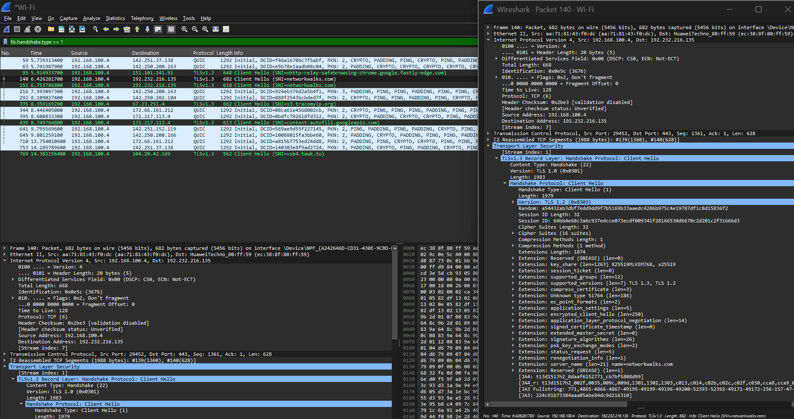
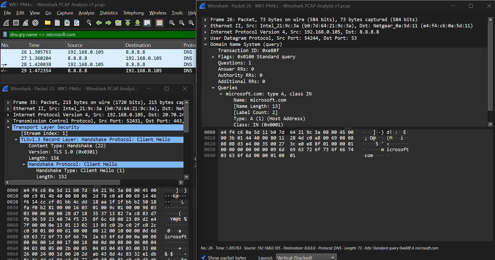
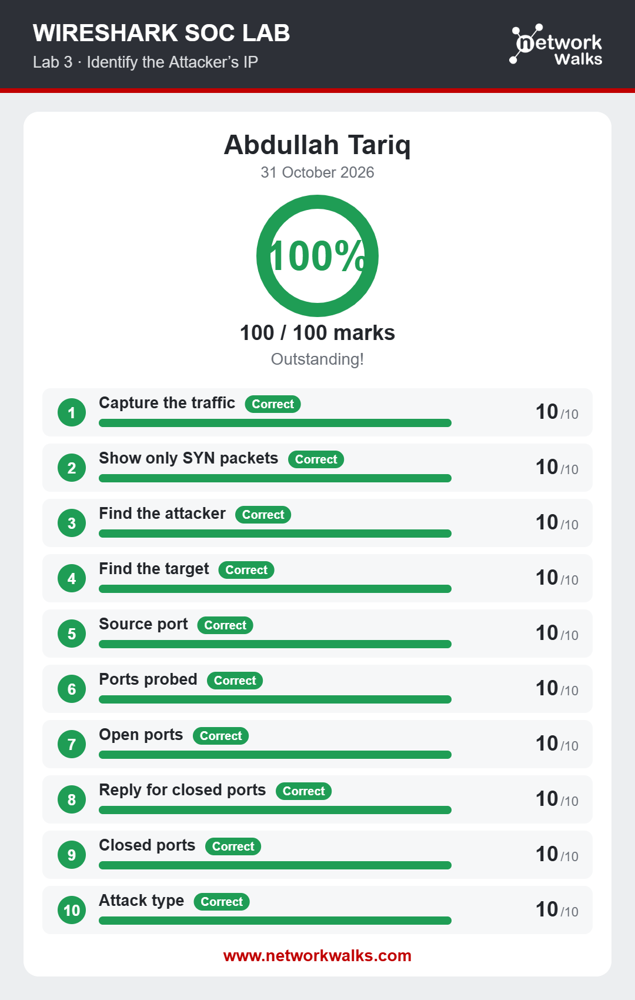
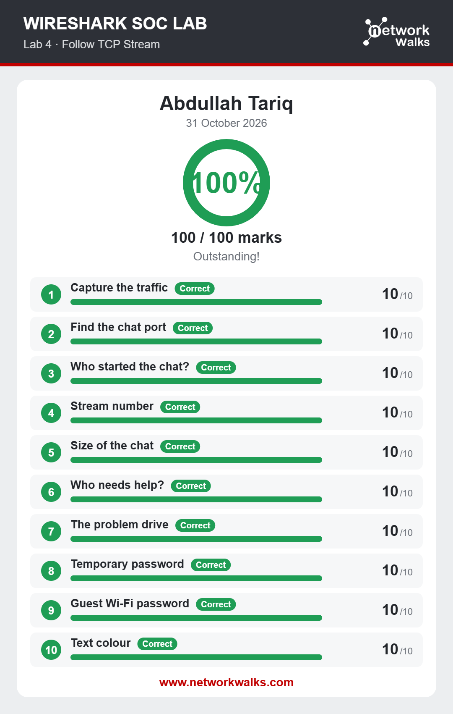
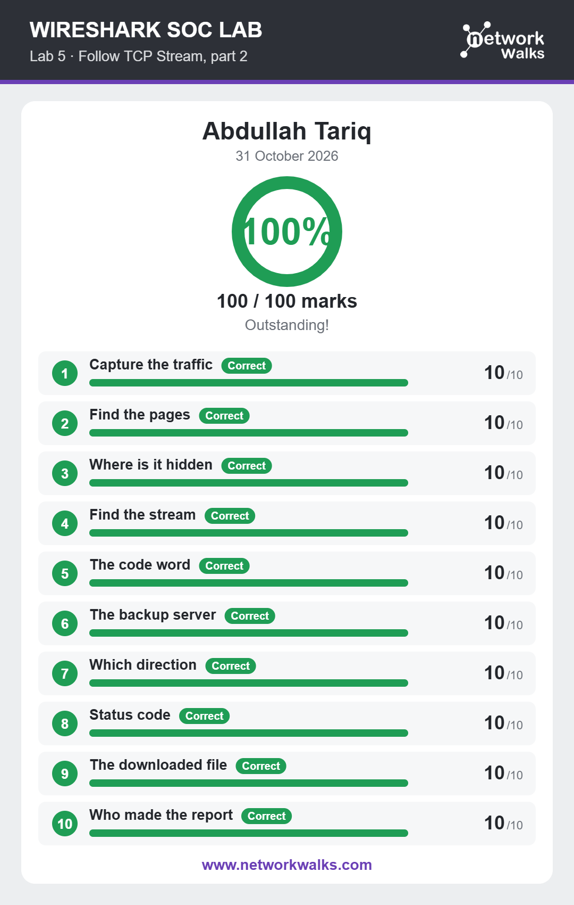
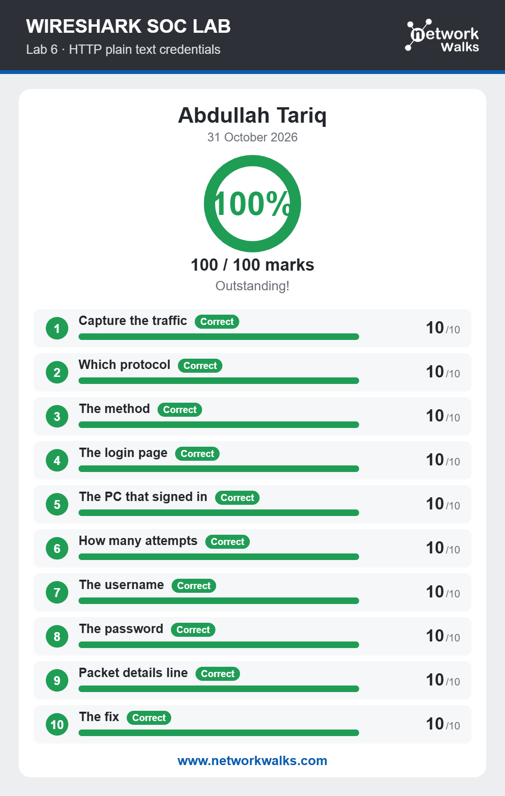
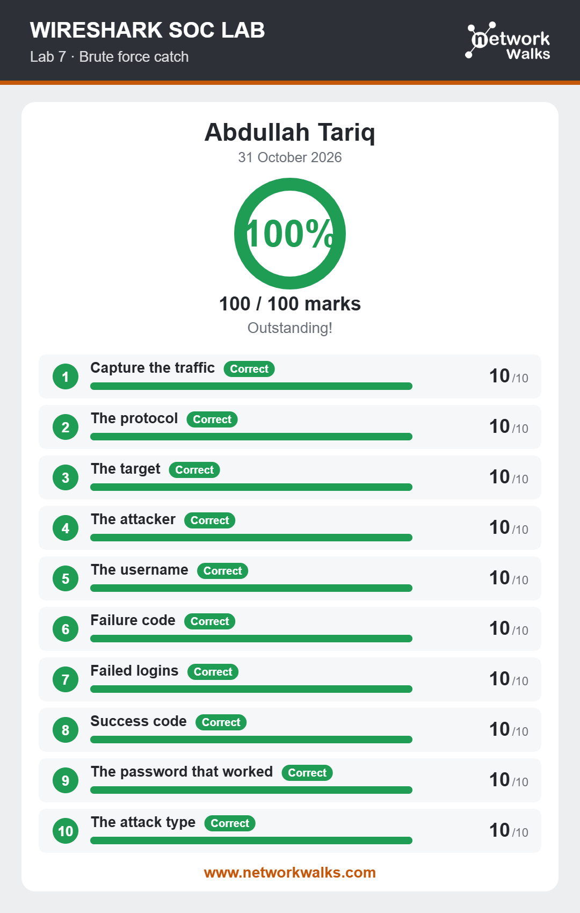
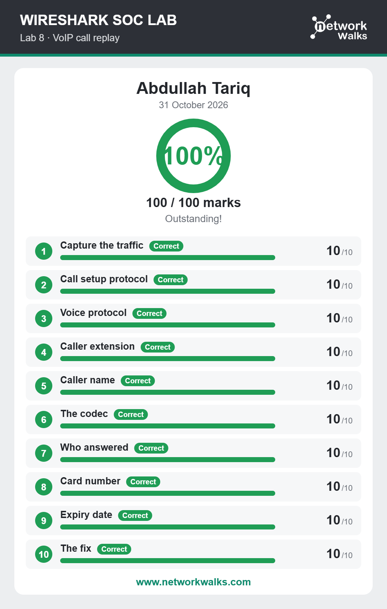

<div align="center">

# 🔐 Cybersecurity Lab Environment Setup

**Building an isolated virtual lab for penetration testing and ethical hacking practice**
</div>


<p align="center">
  
  
  
  
  
  
</p>


---

## 📌 Project Overview

This project focuses on setting up a **virtual cybersecurity and penetration-testing laboratory** using VirtualBox, Kali Linux and some other Operating Systems acting as targets.

The purpose of the lab is to create a controlled environment where cybersecurity tools, network scanning, reconnaissance, vulnerability assessment, and other security-testing activities can be performed safely and repeatedly.


---

## 📑 Table of Contents

- [📌 Project Overview](#-project-overview)
- [🎯 Objectives](#-objectives)
- [🛡 Purpose of the Lab](#-purpose-of-the-lab)
- [🏗 Lab Architecture](#-lab-architecture)
- [⚙ Lab Configuration](#-lab-configuration)
- [🪜 Lab Setup Procedure](#-lab-setup-procedure)
- [🧰 Lab Work: Wireshark](#-lab-work-wireshark)
- [📂 In Case of Other VMs or Target Machines](#-in-case-of-other-vms-or-target-machines)
- [🔎 Lab Verification](#-lab-verification)
- [🐞 Problems Encountered & Solutions](#-problems-encountered--solutions)
- [💡 What I Learned](#-what-i-learned)
- [🔐 Security & Ethical Use](#-security--ethical-use)
- [🔗 Tools & Resources](#-tools--resources)
- [👤 Author](#-author)


---

## 🎯 Objectives

The main objectives of this project are to:

- Install and configure VirtualBox.
- Install/import Kali Linux and other Operating Systems as virtual machines.
- Create a private **NAT Network** for the cybersecurity lab.
- Configure network connectivity for these Operating Systems.
- Assign a consistent IP address to each Operating System.
- Verify network connectivity.
- Take a clean VM snapshot for recovery.
- Document the complete setup process.

---

# 🛡 Purpose of the Lab

The lab provides an isolated and controlled environment for cybersecurity learning and authorized security testing.

It can be used for activities such as:

- Network reconnaissance
- Port scanning
- Vulnerability assessment
- Packet analysis
- Web security testing
- Exploitation practice
- Security-tool experimentation

⚠️ **Important:** This laboratory must only be used for systems that you own or have explicit permission to test. Do not use the lab or its tools to attack unauthorized systems.

---


# 🏗 Lab Architecture

The laboratory uses Oracle VirtualBox to run Kali Linux as the
security-testing machine alongside Windows and Android target VMs.
All machines are configured to use the same NAT Network for
internal connectivity and, where configured, outbound access.


### 🔑 Virtual Machine and IP Mapping

| Virtual Machine | Role | IP Address |
|---|---|---|
| Kali Linux | Security Testing | `10.0.0.2` |
| Windows 10 | Client Target | `10.0.0.3` |
| Windows 11 | Client Target | `10.0.0.4` |
| Windows 7 | Legacy Target | `10.0.0.5` |
| Android-x86 | Mobile Target | `10.0.0.6` |
| NAT Network Gateway | Default Gateway | `10.0.0.1` |

> **Note:** These are the intended addresses for the lab.
> Verify actual assignments and gateway settings against the
> VirtualBox configuration and guest operating systems.

---

# ⚙ Lab Configuration

| 🧩 Component       | ⚙️ Configuration   |
| ------------------ | ------------------  |
| 🖥️ Host OS         | Windows 11         |
| 🧠 Host RAM        | 8 GB               |
| ⚡ Processor       | Intel Core i7      |
| 🧰 Hypervisor      | VirtualBox 7.2  |
| 🐉 Security OS     | Kali Linux 2026.3  |
| 🧠 Kali RAM        | 1500 MB            |
| 🌐 Virtual Network | NAT Network        |
| 📡 Network Address | 10.0.0.0/24        |
| 🐧 Kali IP Address | 10.0.0.2/24        |
| 🚪 Default Gateway | 10.0.0.1           |
| 🌍 DNS Server      | 8.8.8.8            |
| 🔮 Remaining VM Range        | 10.0.0.3–10.0.0.99 |

---

# 🪜 Lab Setup Procedure


## Step 1. Install VirtualBox

VirtualBox was installed as the hypervisor. Remember to enable virtualization in your system's bios to make sure that no errors related to virtualization may occur.

---

## Step 2. Create the NAT Network

A dedicated NAT Network was created in VirtualBox.
```text
Configuration:
Network Name: NatNetwork
IPv4 Prefix:  10.0.0.0/24
DHCP:         Enabled
IPv6:         Disabled
```


A **NAT Network** was selected because multiple virtual machines connected to the same NAT Network can communicate with one another while also having outbound network connectivity.

This will allow future attacker and target VMs to communicate within the lab.


---

## Step 3. Import Kali Linux

The Kali Linux virtual machine was downloaded from the official Kali Linux website and imported into VirtualBox.

The VM network adapter was configured as follows:


The VM was allocated:

```text
RAM: 1500 MB
```


A shared folder was also configured for transferring required files between the host operating system and the Kali VM.


---

## Step 4. Configure the Kali Linux Network

The Kali Linux network configuration was checked and configured with a consistent IPv4 address.

Example configuration:

```text
IP Address: 10.0.0.2
Subnet Mask: 255.255.255.0
Gateway: 10.0.0.1
DNS: 8.8.8.8
```


A consistent IP address makes it easier to document the lab and reference the Kali machine in future exercises.


---

## Step 5. Create a Clean VM Snapshot

After completing the initial configuration, a VirtualBox snapshot was created.

Example snapshot name:

```text
Clean Kali - Network Setup
```


The snapshot represents the clean baseline of the laboratory.

If a future exercise changes or damages the VM configuration, the machine can be restored to this baseline.


---

## 📂 In Case of Other VMs or Target Machines

> **Note:** Follow the equivalent VM setup, resource allocation,
> network configuration, and verification procedures used for Kali
> Linux. The screenshots and configuration evidence for each target
> are available in the corresponding directory. Some steps may vary
> depending on the operating system.

- 📁 [Windows 10 VM](2-Win10VM/) — Environment settings and security configuration.
- 📁 [Windows 11 VM](3-Win11VM/) — VirtualBox resources and installation evidence.
- 📁 [Windows 7 VM](4-Win7VM/) — Legacy VM deployment and resource settings.
- 📁 [Android VM](5-AndroidVM/) — Installation, architecture, and interface verification.
- 📁 [Connectivity Tests](6-Connectivity/) — Cross-VM ping tests and connectivity evidence.


---


## 🔎 Lab Verification

Run the following commands from Kali Linux to verify addressing
and connectivity. Actual results and screenshots are documented
in the `6-Connectivity/` directory.

| Test | Command | Expected Outcome |
|---|---|---|
| Check network interfaces | `ip a` | Intended IP address is assigned |
| Test gateway | `ping -c 4 10.0.0.1` | Replies if the gateway responds to ICMP |
| Test Windows 10 | `ping -c 4 10.0.0.3` | Replies if reachable and ICMP is allowed |
| Test Windows 11 | `ping -c 4 10.0.0.4` | Replies if reachable and ICMP is allowed |
| Test Windows 7 | `ping -c 4 10.0.0.5` | Replies if reachable and ICMP is allowed |
| Test Android | `ping -c 4 10.0.0.6` | Replies if reachable and ICMP is allowed |


*Figure: Example cross-VM connectivity test.*


---

# 🧰 Lab Work: Wireshark

I used **Wireshark** to capture live network traffic and analyze packet captures (PCAPs) for security issues. It was an extra module in this project. 

### Lab 1: Network Traffic Analysis

- **Objective:** Capture and examine network traffic using Wireshark.
- **Activity:** Captured packets and explored their details to understand network communication.
- **Learning Outcome:** Learned the basics of packet capturing and network traffic analysis.

<details>
<summary>📸 View Lab 1 Completion Proof</summary>



</details>

### Lab 2: Wireshark Packet Filtering

- **Objective:** Learn how to filter and analyze specific network traffic.
- **Activity:** Applied Wireshark display filters and examined different protocols and packets.
- **Learning Outcome:** Learned how to find specific packets and understand their contents.

<details>
<summary>📸 View Lab 2 Completion Proof</summary>



</details>

Here is the complete modified Markdown for Labs 3–8. Everything remains unchanged except that Platform is now placed after Learning Outcome.

### Lab 3: Network Traffic Investigation

- **Objective:** Investigate captured network traffic and identify important findings.
- **Activity:** Analyzed packets, inspected network communication, and documented the results.
- **Learning Outcome:** Gained practical experience in identifying and investigating network activity.
- **Platform:** Completed online in the browser using [NetworkWalks – Lab 3: Identify the Attacker's IP](https://networkwalks.com/wireshark-lab3/).

<details>
<summary>📸 View Lab 3 Completion Proof</summary>



</details>

### Lab 4: Follow TCP Stream

- **Objective:** Understand TCP communication using Wireshark.
- **Activity:** Captured network traffic and used Follow TCP Stream to view conversations between devices.
- **Learning Outcome:** Learned how to follow TCP connections and inspect exchanged messages.
- **Platform:** Completed online in the browser using [NetworkWalks – Lab 4: Follow TCP Stream](https://networkwalks.com/wireshark-lab4/).

<details>
<summary>📸 View Lab 4 Completion Proof</summary>



</details>

### Lab 5: Follow TCP Stream – Part 2

- **Objective:** Explore TCP streams and find useful information in network traffic.
- **Activity:** Inspected HTTP requests and examined data exchanged between hosts.
- **Learning Outcome:** Learned how to inspect web traffic using TCP streams.
- **Platform:** Completed online in the browser using [NetworkWalks – Lab 5: Follow TCP Stream, Part 2](https://networkwalks.com/wireshark-lab5/).

<details>
<summary>📸 View Lab 5 Completion Proof</summary>



</details>

### Lab 6: HTTP Plain Text Credentials

- **Objective:** Understand the risks of sending login details over unencrypted HTTP.
- **Activity:** Captured HTTP traffic and identified credentials transmitted in plain text.
- **Learning Outcome:** Understood why HTTPS is important for protecting login information.
- **Platform:** Completed online in the browser using [NetworkWalks – Lab 6: HTTP Plain Text Credentials](https://networkwalks.com/wireshark-lab6/).

<details>
<summary>📸 View Lab 6 Completion Proof</summary>



</details>

### Lab 7: Brute Force Catch

- **Objective:** Identify brute-force login attempts through network traffic.
- **Activity:** Examined repeated login attempts and identified suspicious authentication activity.
- **Learning Outcome:** Learned how to recognize brute-force attacks through packet analysis.
- **Platform:** Completed online in the browser using [NetworkWalks – Lab 7: Brute Force Catch](https://networkwalks.com/wireshark-lab7/).

<details>
<summary>📸 View Lab 7 Completion Proof</summary>



</details>

### Lab 8: VoIP Analysis

- **Objective:** Understand how voice communication works over a network.
- **Activity:** Captured and examined VoIP traffic to explore call-related packets.
- **Learning Outcome:** Learned how to inspect VoIP communication using Wireshark.
- **Platform:** Completed online in the browser using [NetworkWalks – Lab 8: VoIP Call Replay](https://networkwalks.com/wireshark-lab8/).

<details>
<summary>📸 View Lab 8 Completion Proof</summary>



</details>

## 🔍 Wireshark Quick Reference

| Filter | Description |
|---|---|
| `ip.addr == 192.168.1.10` | Filter traffic by IP address |
| `tcp` / `udp` | Show TCP / UDP traffic |
| `tcp.stream eq 0` | Filter a specific TCP stream |
| `tcp.flags.syn == 1` | Find TCP SYN packets |
| `http` | Show HTTP traffic |
| `http.request` | Show HTTP requests |
| `http.response` | Show HTTP responses |
| `http.request.method == "GET"` | Find GET requests |
| `http.request.method == "POST"` | Find POST requests |
| `http.response.code == 200` | Find successful HTTP responses |
| `http.response.code == 401` | Find unauthorized responses |
| `http.host` | Identify HTTP hostnames |
| `http.request.uri` | View requested URLs |
| `dns` | Show DNS traffic |
| `ftp` | Show FTP traffic |
| `sip` | Show SIP signaling packets |
| `rtp` | Show RTP voice packets |
| `rtcp` | Show RTP control traffic |
| `udp.port == 5060` | Filter common SIP traffic |
| `tcp.analysis.retransmission` | Find TCP retransmissions |
| `icmp` | Show ICMP traffic |

---


# 🐞 Problems Encountered & Solutions

Documenting problems is an important part of the project.

## Problem 1. Internet Connectivity After Static IP Configuration

After manually configuring the IPv4 settings, Internet connectivity may fail depending on the Kali/NetworkManager configuration.

One workaround used during this lab was:

```bash
sudo nmcli connection modify "Wired connection 1" ipv4.dad-timeout 0
```

The network connection was then restarted/rebooted and connectivity was tested again.

> **Important:** Network interface and connection names may differ between systems. Students should first identify their actual connection name before running an `nmcli` command.

---

## Problem 2. Target Windows VMs Dropping Ping Requests (ICMP Blocked by Default)

During connectivity verification, the Kali Linux machine could not receive ping responses from the Windows target virtual machines (`10.0.0.3`, `10.0.0.4`, `10.0.0.5`), resulting in `100% packet loss`. 

### Cause
By default, the built-in Windows Defender Firewall blocks all inbound Internet Control Message Protocol (ICMP) Echo Requests. This prevents the target machines from responding to scanning or reconnaissance attempts from the attacker platform, even though they are active on the same `NatNetwork`.

### Solution
The issue was resolved by enabling the predefined inbound firewall rule on each Windows guest OS to explicitly allow ICMPv4 traffic:

1. Open the **Run** dialog box (`Win + R`), type `wf.msc`, and press **Enter** to open *Windows Defender Firewall with Advanced Security*.
2. Click on **Inbound Rules** in the left-hand pane.
3. Scroll down to locate the predefined rule: **File and Printer Sharing (Echo Request - ICMPv4-In)**.
4. Right-click the rule and select **Enable Rule** for the appropriate network profile (Private/Public).

Once enabled, cross-VM communications succeeded immediately, yielding successful ICMP replies on the Kali Linux terminal.

---

# 💡 What I Learned

Through this project, I learned how to create and configure a virtual environment for cybersecurity practice.

The most important concepts I learned include:

### 1. NAT vs NAT Network

A standard NAT configuration and a NAT Network serve different purposes.

A NAT Network allows multiple VMs connected to the same virtual network to communicate with one another while providing network address translation for external connectivity.

This makes it useful for building a multi-machine cybersecurity laboratory.

### 2. Virtual Machine Networking

I learned how VirtualBox virtual network adapters connect virtual machines to different types of networks and how network configuration affects communication between machines.

### 3. Static IP Configuration

I learned how to configure and verify IPv4 addressing, subnet masks, gateways, and DNS settings in Kali Linux.

### 4. VM Snapshots

I learned that a clean snapshot should be created **before performing risky or experimental activities**.

This provides a known-good recovery point for future cybersecurity exercises.

### 5. Documentation

I learned that documenting commands, configuration, screenshots, problems, and solutions is an important part of a professional cybersecurity project.

### 6. Packet Analysis with Wireshark
- I learned how to look inside individual network packets to find IP addresses, ports, and protocols instead of just testing basic connections.
- I learned how firewalls and servers reply differently to connection attempts when a port is open (`SYN, ACK`) versus when a port is closed (`RST, ACK`).

---

# 🔐 Security & Ethical Use

This laboratory is intended strictly for education purposes only.

---

# 🔗 Tools & Resources

- **VirtualBox:** https://virtualbox.org
- **Kali Linux:** https://kali.org
- **Wireshark official installers:** https://www.wireshark.org/download.html
- **Online SOC Lab environment:** https://networkwalks.com/wireshark


---

# 👤 Author

**Abdullah Tariq**\
Cybersecurity Professional B084

LinkedIn: [Abdullah Tariq](https://www.linkedin.com/in/abdullah-tariq-202301340485gb/)

---

## 📌 Project Information

**Program Name:** Cybersecurity at Networkwalks | **Week:** 01 | **Project:** Cybersecurity & Pentesting Lab Setup | **Repository:** GitHub
